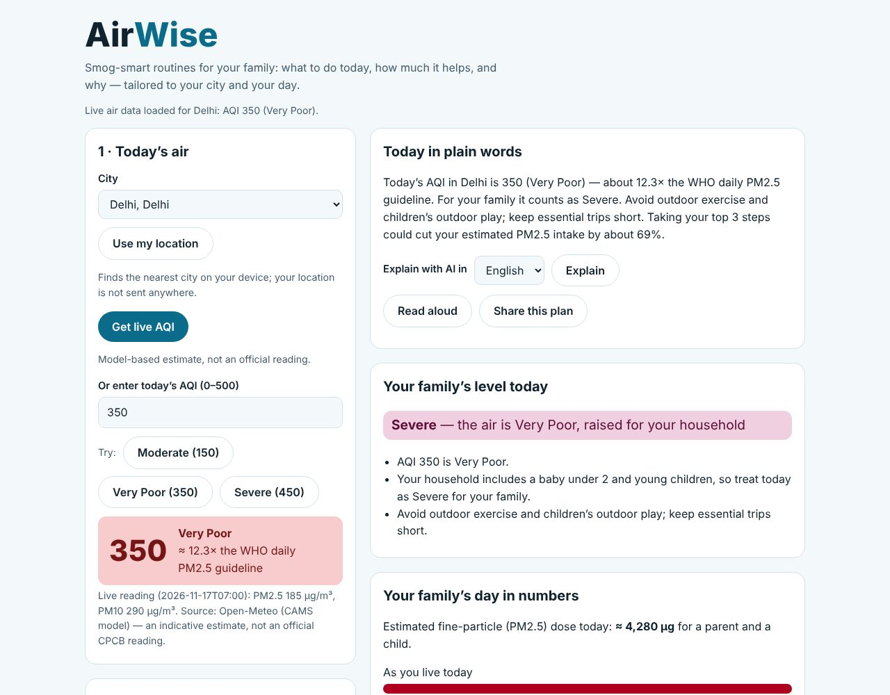
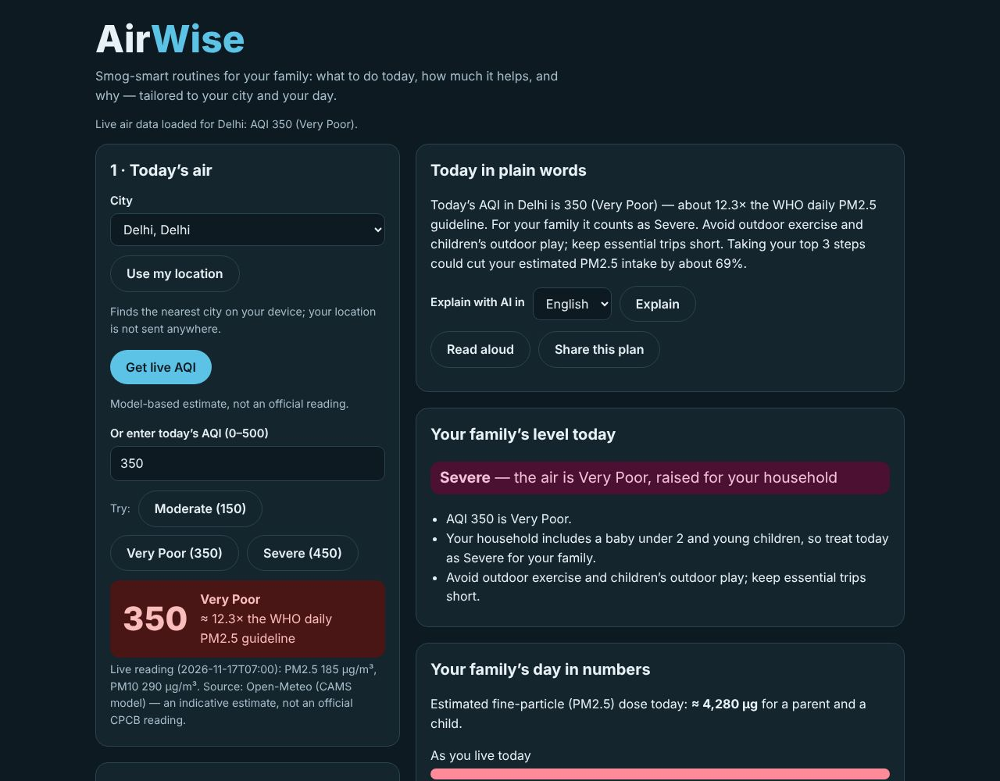
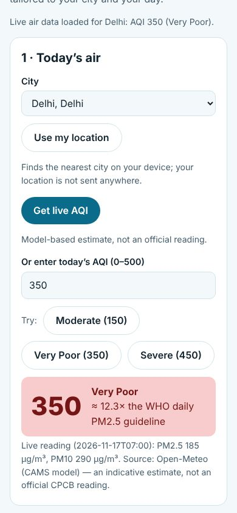
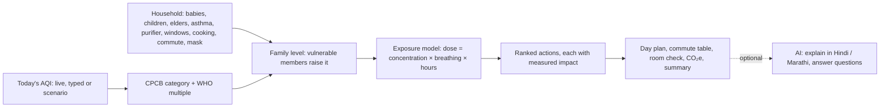
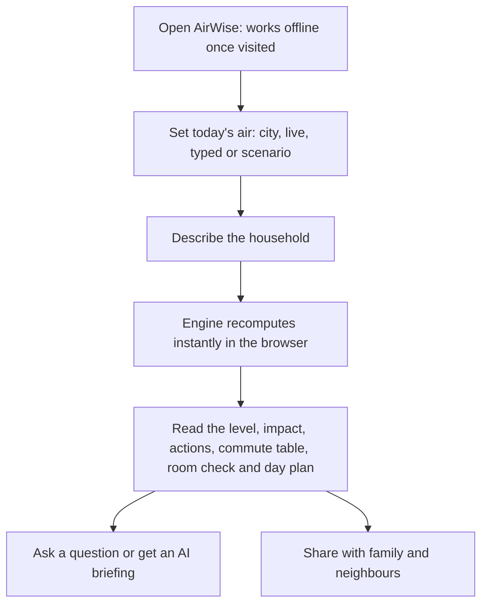

<div align="center">

# 🌫️ AirWise

### A GenAI assistant that helps families and communities breathe easier through severe winter smog

Low-emission daily routines · indoor air hacks · sustainable alternatives · and the **direct impact of every choice, in numbers**, tailored to your city and your day.

 -42%20passing-brightgreen>)      -0-brightgreen>)  

**Live demo:** _add your Cloud Run URL here after running `./deploy/deploy.sh`_

<table>
  <tr>
    <td></td>
    <td></td>
    <td></td>
  </tr>
</table>

</div>

## Contents

[1. Chosen vertical](#1-chosen-vertical) · [2. Approach and logic](#2-approach-and-logic) · [3. How the solution works](#3-how-the-solution-works) · [4. Assumptions made](#4-assumptions-made) · [Evidence for the six evaluation areas](#evidence-for-the-six-evaluation-areas) · [Security and responsible AI](#security-and-responsible-ai) · [Accessibility](#accessibility) · [Deploy](#deploy-to-google-cloud) · [Docs](#documentation)

---

## 1. Chosen vertical

**Urban air quality and family public health in winter smog: families with young children and older adults in smog-hit Indian cities.**

### Problem addressed

- **Smog is severe and prolonged.** Winter inversions trap pollution near the ground and push the AQI past 300–400 for days, many times the WHO daily PM2.5 guideline.
- **Advice is generic.** "Avoid going out" ignores a baby at home, a two-wheeler commute, windows that never close, or a chulha in the kitchen.
- **Indoor air is overlooked.** Most exposure happens at home, yet families do not know what their room needs or that a DIY filter costs a fraction of a purifier.
- **Choices feel pointless.** People are told to "reduce emissions" with no sense of how much any single choice helps them or their neighbourhood.

### Target users

| User                                                   | What they need                                                                                                     |
| ------------------------------------------------------ | ------------------------------------------------------------------------------------------------------------------ |
| Families with babies, children, older adults or asthma | Safe outdoor windows, indoor-air hacks and exposure cuts they can act on today                                     |
| Urban commuters                                        | Which way to travel hurts least, in particulates and in carbon                                                     |
| Communities: parents' groups, colonies, schools        | Shareable plans and collective actions (school sports indoors, no open burning, neighbours checking on each other) |

### Why it is relevant

Weather and AQI apps show one citywide number. AirWise answers three questions instead: **what should _we_ do today, how much will it help, and why?** It reads today's air for the family's city, applies documented rules and a transparent exposure model to their situation, and explains the direct impact of every choice.

---

## 2. Approach and logic

### Overall approach

A decoupled, privacy-first design with three parts:



1. **Decision engine** (`shared/`): pure, deterministic TypeScript. It runs in the browser for instant, offline, private results, and the server tests the very same code.
2. **Server** (`server/`, Express on Cloud Run): live air data (allow-listed cities only), the optional AI, validation, rate limits and structured logs. It stores nothing.
3. **Client** (`client/`, React 19): one hook owns state and server calls; one small component per section.

> **Numbers are computed, words are generated.** Every impact figure comes from a transparent, adjustable model ([docs/MODEL.md](docs/MODEL.md)). The AI only explains and answers, and everything works without it.

### Key decisions and trade-offs

| Decision                                        | Why                                                                    | Trade-off                                                 |
| ----------------------------------------------- | ---------------------------------------------------------------------- | --------------------------------------------------------- |
| Engine in the browser                           | Instant, offline and private: household details never leave the device | Logic ships to the client (about 104 kB gzipped in total) |
| Rules and a model, with AI only for explanation | Safe, explainable and testable; no invented numbers                    | Less free-form than an LLM-only answer                    |
| Vertex AI with the service account (no API key) | Nothing to leak; least privilege                                       | Needs a Google Cloud project                              |
| Allow-listed cities, one fixed outbound host    | No SSRF, no abuse of the live-data call                                | 21 cities, not every town                                 |
| Every dependency has a fallback                 | Live data fails → type the AQI; AI fails → rule-based answers          | A little more code to test                                |
| Strict CSP, no inline scripts, styles or `eval` | Strong injection defence                                               | Styles set through the CSSOM only                         |

### Core algorithms

| Algorithm              | What it does                                                                                                                         | Code                 |
| ---------------------- | ------------------------------------------------------------------------------------------------------------------------------------ | -------------------- |
| CPCB AQI interpolation | PM2.5 and PM10 → India's AQI (0–500) and category; inverse for typed AQIs                                                            | `shared/aqi.ts`      |
| Family level           | Vulnerable members raise the same air one or two steps; maps to _ok / limit / avoid_                                                 | `shared/risk.ts`     |
| Exposure model         | Fine-particle dose for a reference adult and child from time, place, mask, purifier, windows, cooking and breathing rate             | `shared/exposure.ts` |
| Impact measurement     | Re-runs the model with the household changed by each action to get the true % drop; combines top steps without doubling alternatives | `shared/actions.ts`  |
| Best and worst hours   | Cleanest and dirtiest two-hour windows from the live hourly forecast                                                                 | `shared/windows.ts`  |
| Commute comparison     | Same daily distance by every mode: time, PM2.5 breathed in, weekly CO₂e                                                              | `shared/commute.ts`  |
| Room check             | Mass balance: CADR for 4 air changes an hour and minutes to clear 90%                                                                | `shared/iaq.ts`      |
| Emergency detection    | Possible medical emergencies get a fixed "call 112" message before any AI call                                                       | `shared/ask.ts`      |

### Technology stack

| Layer     | Choice                                                                                                          |
| --------- | --------------------------------------------------------------------------------------------------------------- |
| Frontend  | React 19, TypeScript (strict), Vite, hand-written accessible CSS (no UI or chart library)                       |
| Backend   | Node 22, Express 5, Zod 4, helmet, express-rate-limit, compiled with esbuild                                    |
| AI        | Gemini 2.5 Flash on Vertex AI (Application Default Credentials) or the Gemini API; offline rule-based fallback  |
| Live data | Open-Meteo air quality (CAMS model), allow-listed cities only                                                   |
| Quality   | Vitest, Testing Library, Supertest, fast-check, axe-core, Playwright, Stryker, ESLint (with jsx-a11y), Prettier |
| Cloud     | Cloud Run, Vertex AI, Cloud Logging, GitHub Actions, CodeQL, Dependabot                                         |

---

## 3. How the solution works

### Modules

1. **Today's air.** Pick a city or tap **Use my location** (matched to the nearest listed city on the device; coordinates are never sent). **Get live AQI**, type today's value, or try a scenario. Shows the category and how many times the WHO guideline it is.
2. **Your household.** Counts and habits only, never names: babies under 2, children, older adults, asthma, purifier, windows, cooking fuel, commute, children's outdoor time, exercise, mask. Stored in this browser only.
3. **Your family's level and impact.** The family level, the estimated daily PM2.5 dose, where it comes from, and what the top steps would change.
4. **What to do, and what it changes.** 20 personalised actions across routine, indoor air, commute, sustainable and community, each with its measured % drop in intake, effort, ₹ cost and a plain-language why.
5. **How your commute choices compare.** Time, particles breathed in and CO₂e for every way of travelling.
6. **Room-by-room air check.** What a room needs, what a purifier delivers, and how to build a DIY Corsi–Rosenthal box.
7. **Your low-emission day.** Four parts of the day, plus the **best and worst two hours outdoors today** from the live forecast.
8. **Ask AirWise.** Grounded Q&A with rule-based fallback and emergency detection; AI briefings in English, Hindi and Marathi; **Read aloud**; **Share this plan** for WhatsApp.

### End-to-end journey



### Worked example

A Delhi family with a baby and a child, a two-wheeler commuter, windows usually open, LPG cooking and no purifier, on a day with **AQI 350**:

|                                     |                                                                                                                  |
| ----------------------------------- | ---------------------------------------------------------------------------------------------------------------- |
| Air today                           | **Very Poor**, about 12× the WHO daily PM2.5 guideline                                                           |
| Family level                        | **Severe** (a baby and a child raise it two steps)                                                               |
| Estimated daily PM2.5 dose          | ≈ 4,280 µg                                                                                                       |
| Where it comes from                 | ≈ 69% from time at home, 14% cooking fumes, 6% commute, 6% children's outdoor time, 5% exercise                  |
| Top steps and their measured impact | HEPA purifier **−49%** (or a DIY box **−41%**) · keep windows shut **−27%** · fitted N95 for the commute **−8%** |
| All three together                  | **≈ −69%** (to ≈ 1,340 µg)                                                                                       |
| Safety first                        | Keep the baby indoors; never put a mask on a baby under 2                                                        |

The point: **most exposure happens at home**, so indoor air matters more than the commute.

### Run it

```bash
git clone <your-repo-url> && cd airwise
npm ci
npm run dev:server        # API on :8787 (works with no API key)
npm run dev:client        # UI on :5173
```

Production build (UI and API on one port): `npm run build && npm start`. Configuration is optional; see `.env.example`.

### Verify it in two minutes

```bash
npm run check                       # format · lint · types · 313 tests @ 100% coverage · build · bundle budget
npx playwright install chromium
npm run test:e2e                    # 42 real-browser tests (desktop + mobile)
npm audit --omit=dev                # 0 vulnerabilities
```

---

## 4. Assumptions made

### Data

| Assumption                      | Detail                                                                                                                                  |
| ------------------------------- | --------------------------------------------------------------------------------------------------------------------------------------- |
| AQI follows India's CPCB scale  | Categories and PM2.5/PM10 breakpoints are CPCB's; the open top bands use 380 µg/m³ (PM2.5) and 510 µg/m³ (PM10) as interpolation bounds |
| Live data is an estimate        | Open-Meteo (CAMS model) values are indicative, not official monitor readings; the app says so wherever they appear                      |
| Winter smog is mostly PM2.5     | A typed AQI is converted back to PM2.5; other pollutants are not modelled                                                               |
| Forecast is for the city centre | The hourly forecast is used to pick best and worst hours; local conditions vary                                                         |
| 21 listed cities                | Chosen for smog exposure and coverage; anywhere else, type today's AQI                                                                  |

### The household and its day

| Assumption                                  | Detail                                                                                                                                                                                |
| ------------------------------------------- | ------------------------------------------------------------------------------------------------------------------------------------------------------------------------------------- |
| One reference adult and one reference child | Stand in for the household; real days vary                                                                                                                                            |
| Breathing rates                             | Adult 0.5 / 1.0 / 2.5 m³/h at rest / light / exercise; child 0.35 / 0.7 / 1.5 m³/h                                                                                                    |
| Homes follow outdoor air                    | 90% of outdoor PM2.5 indoors with windows open, 60% when kept closed                                                                                                                  |
| Purifiers are sized for the room            | HEPA × 0.4, DIY box × 0.5 indoor level, with fresh filters                                                                                                                            |
| Masks are worn properly, by adults only     | N95 lets 25% through, surgical 65%, cloth 80%; never advised for babies under 2                                                                                                       |
| Cooking adds particles                      | Wood, dung or coal +80 µg/m³, LPG +10, induction 0, for two hours a day                                                                                                               |
| Commutes                                    | Walk 5 km/h, two-wheeler 25, car 22, bus 18, metro 30; in-vehicle air relative to outdoors 1.0 / 1.3 / 0.5 / 0.9 / 0.6; carbon 0 / 0.06 / 0.17 / 0.05 / 0.03 kg CO₂e per passenger-km |
| Costs are indicative                        | ₹ ranges are typical, not quotes                                                                                                                                                      |

All constants live in one `MODEL` object and are explained in [docs/MODEL.md](docs/MODEL.md).

### Environment and limits

| Assumption                     | Behaviour                                                                                  |
| ------------------------------ | ------------------------------------------------------------------------------------------ |
| The AI is optional             | No key or credentials: rule-based answers and manual AQI, with every feature still working |
| No accounts, no server storage | Household details stay in the browser; clearing the browser clears them                    |
| Live data can fail             | The app says so and falls back to typed AQI; the deploy script smoke-tests it              |
| Not medical advice             | General guidance only; possible emergencies are redirected to 112 or a doctor              |
| Models are approximations      | Rounded, literature-informed values for education, not measurements                        |

---

## Evidence for the six evaluation areas

| Area                  | Evidence                                                                                                                                                                                               | Detail                                            |
| --------------------- | ------------------------------------------------------------------------------------------------------------------------------------------------------------------------------------------------------ | ------------------------------------------------- |
| **Code quality**      | Strict TypeScript, no `any`; a pure shared engine; one hook and one small component per section; ESLint limits on complexity, function and file size; 2,587 source lines with 0.96 test lines per line | [CODE_QUALITY.md](docs/CODE_QUALITY.md)           |
| **Security**          | Strict CSP (no inline script, style or `eval`); strict validation; SSRF allow-list; prompt-injection fencing; emergency short-circuit; no key on GCP; OWASP Top 10 mapping; pinned CI actions          | [SECURITY.md](SECURITY.md)                        |
| **Efficiency**        | Engine in the browser; 104 kB first-load JS (budget enforced); cached and time-boxed calls; Lighthouse 100; scale-to-zero                                                                              | [EFFICIENCY.md](docs/EFFICIENCY.md)               |
| **Testing**           | 313 unit, property, API, component and contract tests at **100% coverage (enforced)**; 42 real-browser tests; mutation score **98.9%**                                                                 | [TESTING.md](docs/TESTING.md)                     |
| **Accessibility**     | WCAG 2.2 AA mapping; fieldset/legend groups; real tables; live regions; `role="alert"` emergencies; `lang` on Hindi and Marathi; Read aloud; axe with real contrast in both themes                     | [ACCESSIBILITY.md](docs/ACCESSIBILITY.md)         |
| **Problem alignment** | Every sentence of the challenge traced to a feature, its code and its test                                                                                                                             | [PROBLEM_ALIGNMENT.md](docs/PROBLEM_ALIGNMENT.md) |

<details>
<summary><b>Expected results of the verification commands</b></summary>

| Check                                | Result                                                                                             |
| ------------------------------------ | -------------------------------------------------------------------------------------------------- |
| Unit, API, component, contract tests | 313 passed                                                                                         |
| Coverage                             | 100% statements, branches, functions and lines (the build fails below 100%)                        |
| Real-browser end-to-end              | 42 passed: 21 scenarios on a desktop and a Pixel 5 profile                                         |
| axe-core, WCAG 2.2 A/AA              | 0 violations in light and dark themes, with real colour contrast                                   |
| Lighthouse                           | Performance 100 · Accessibility 100 · Best Practices 100 · SEO 100 ([QUALITY.md](docs/QUALITY.md)) |
| First-load JavaScript                | about 104 kB gzipped (budget 105 kB)                                                               |
| Dependency audit (production)        | 0 vulnerabilities                                                                                  |

</details>

## Security and responsible AI

No accounts and no server storage · strict validation and a strict Content-Security-Policy · live data fetched only for allow-listed cities with a time-out · AI replies are schema-validated, length-capped and labelled · possible medical emergencies get a fixed "call 112" message **before** any AI call · babies are never advised to wear masks · location is resolved on the device and never sent · no API key on Google Cloud. See [SECURITY.md](SECURITY.md) and [docs/RESPONSIBLE-AI.md](docs/RESPONSIBLE-AI.md). AirWise gives general guidance, not medical advice.

## Accessibility

Built to WCAG 2.2 AA for families under stress, often on a phone: labelled fieldsets, real tables, a polite status region and an assertive emergency alert, all six AQI colours checked for contrast in light and dark themes, colour never the only signal, `lang` on Hindi and Marathi text, **Read aloud**, a skip link, 24 px targets, reflow to 320 px, reduced motion, and print styles. Verified by axe-core in unit tests and in a real browser. See [docs/ACCESSIBILITY.md](docs/ACCESSIBILITY.md).

## Deploy to Google Cloud

```bash
gcloud auth login
PROJECT_ID=your-project-id ./deploy/deploy.sh      # add MIN_INSTANCES=1 while judges test
```

Deploys to Cloud Run (Mumbai by default) with a least-privilege service account, then smoke-tests health, the assistant, live air data and whether Gemini on Vertex AI is really answering. Troubleshooting and teardown: [docs/DEPLOY-GCP.md](docs/DEPLOY-GCP.md).

<details>
<summary><b>Project structure</b></summary>

```
shared/    Decision engine and schemas used by both sides: aqi, risk, exposure, actions, catalog, daily, windows, commute, iaq, ask
server/    Express app, AI adapters (Vertex, Gemini, offline), live-air provider, env validation, logging
client/    React UI: useAssistant.ts (state + server calls), components/ (one file per section)
e2e/       Playwright real-browser tests and the README screenshot generator
deploy/    One-command Cloud Run deployment
docs/      MODEL, ARCHITECTURE, API, CODE_QUALITY, TESTING, EFFICIENCY, ACCESSIBILITY, RESPONSIBLE-AI, PROBLEM_ALIGNMENT, DEPLOY-GCP, QUALITY
```

</details>

## Documentation

[Problem alignment](docs/PROBLEM_ALIGNMENT.md) · [How it decides (model)](docs/MODEL.md) · [Architecture](docs/ARCHITECTURE.md) · [Code quality](docs/CODE_QUALITY.md) · [Testing](docs/TESTING.md) · [Efficiency](docs/EFFICIENCY.md) · [Accessibility](docs/ACCESSIBILITY.md) · [Security](SECURITY.md) · [Responsible AI](docs/RESPONSIBLE-AI.md) · [API](docs/API.md) · [Deploy on GCP](docs/DEPLOY-GCP.md) · [Quality evidence](docs/QUALITY.md) · [Contributing](CONTRIBUTING.md) · [Changelog](CHANGELOG.md)

## Roadmap ideas

School and workplace advisories · neighbourhood sensor data (CPCB, SAFAR, community monitors) · reminders when tomorrow's forecast worsens · more interface languages.

## License

[MIT](LICENSE) · Contributions welcome: see [CONTRIBUTING.md](CONTRIBUTING.md) and the [Code of Conduct](CODE_OF_CONDUCT.md).
