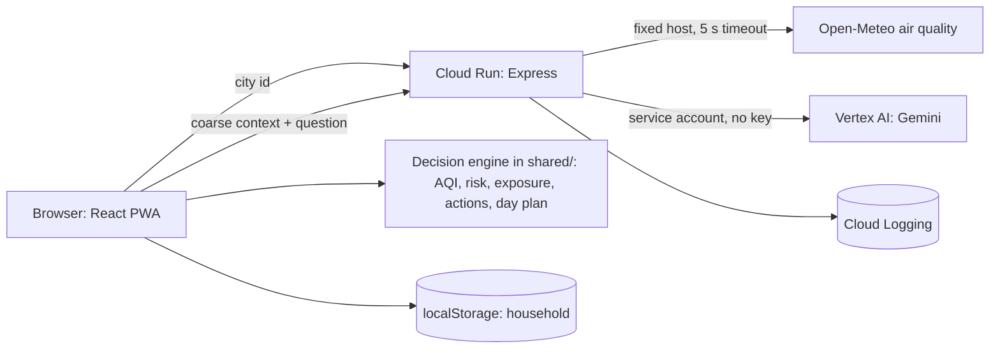

# Architecture

## Key decisions

| Decision                                                                      | Why                                                                                                                       |
| ----------------------------------------------------------------------------- | ------------------------------------------------------------------------------------------------------------------------- |
| The decision engine runs **in the browser**, from pure functions in `shared/` | Instant, works offline, and household details never have to leave the device; the server tests the same code              |
| Numbers are computed, words are generated                                     | Impact percentages come from a transparent model (see [MODEL.md](MODEL.md)); AI only explains and answers                 |
| AI enriches, never gates                                                      | Live data fails → type the AQI; AI fails → rule-based answers. Every call is time-boxed (10 s per attempt, 25 s total)    |
| One validated, minimal context for the AI                                     | Privacy and safety: no counts, no free text about the family                                                              |
| Allow-listed cities for live data                                             | The outbound URL can never be influenced by a user                                                                        |
| Location is resolved **on the device**                                        | The browser matches its position to the nearest listed city and sends only the city id; coordinates never leave the phone |
| Compiled server and compact client                                            | Fast cold starts on Cloud Run; first-load JavaScript is budgeted and enforced in the build                                |
| Tests at every layer, 100% coverage enforced, plus real-browser tests         | A regression in logic, API or UI fails the build                                                                          |

## Layout

`shared/` decision engine and schemas · `server/` Express app, AI adapters (Vertex, Gemini, offline), live-air provider, env validation, structured logging · `client/` React UI (`useAssistant` owns state and server calls, `components/` has one file per section) · `e2e/` Playwright tests and the screenshot generator · `deploy/` one-command Cloud Run deployment · `docs/` model, API, accessibility, security, deployment.
